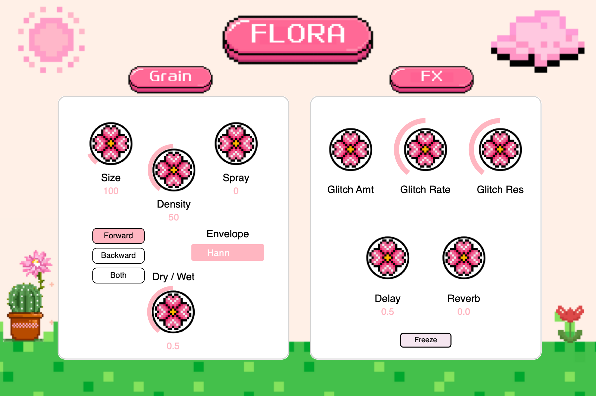

# Flora

Flora is a granular effect plugin (AU, VST3 and standalone) built with JUCE. It slices
incoming audio into short grains and layers them back together, then runs the result
through bitcrushing glitch, delay and reverb effects. The interface is drawn in a pixel-art garden
style.



## Controls

### Grain
- **Size**: grain length, 1 to 1000 ms.
- **Density**: how often new grains start.
- **Spray**: random offset of where each grain reads from in the recent audio.
- **Direction**: play grains forward, backward or a random mix of both.
- **Envelope**: the fade shape of each grain (Hann, Hamming, Percussive, Exponential
  Decay, Reverse Exponential Decay, Cosine).
- **Dry / Wet**: balance between the input and the granulated signal.

### FX
- **Glitch Amount**: mix of the glitch effect, a bitcrusher and sample-rate reducer.
- **Glitch Rate**: how fast the glitch switches on and off, from 1 to 100 times a second.
- **Glitch Res**: low settings crush the bit depth (down to 4-bit); high settings keep 16-bit but downsample harder.
- **Delay**: level of a 500 ms stereo feedback delay.
- **Reverb**: reverb level.
- **Freeze**: stops new audio entering the delay, so the current echoes keep looping.

## Building

Requires CMake 3.15 or later and Xcode on macOS. JUCE 8.0.6 is included as a git
submodule.

```bash
git clone --recurse-submodules https://github.com/avanti-singh/Flora.git
cd Flora
cmake -S . -B build -G Xcode -DCMAKE_OSX_ARCHITECTURES="arm64;x86_64"
cmake --build build --config Release --target Flora_VST3 Flora_AU Flora_Standalone
```

The build produces a universal (Apple Silicon and Intel) plugin and copies the AU and
VST3 into `~/Library/Audio/Plug-Ins/`.

## Project layout

```
Source/PluginProcessor.*   audio processing: grain engine, glitch, delay, reverb
Source/PluginEditor.*      interface
Source/RotaryKnob.*        image-based rotary knob
Images/                    background and knob artwork (compiled into the plugin)
JUCE/                      JUCE framework (submodule)
```
